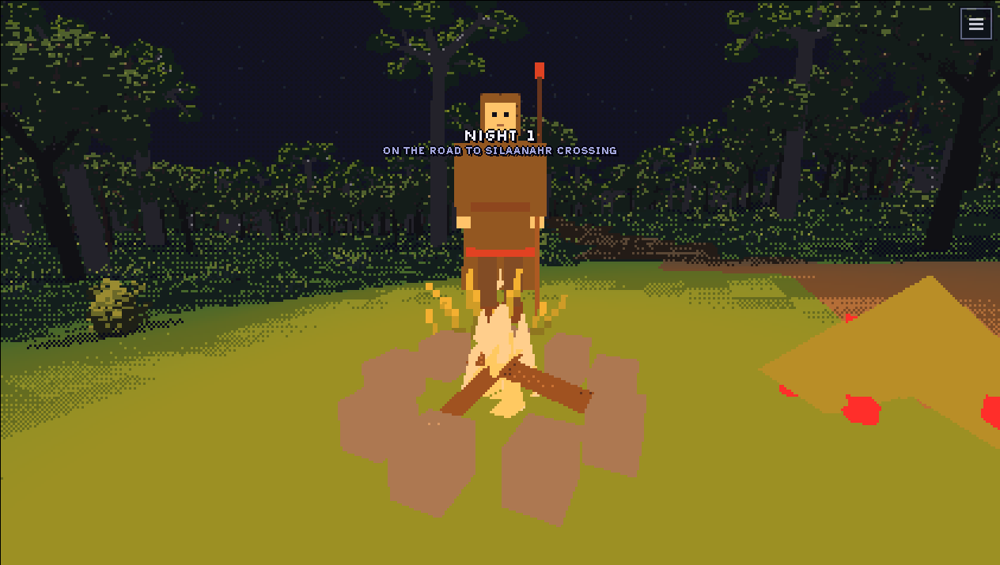

# WORLDSEED — offline mirror

Full mirror of **Worldseed** — the playable HTML5 embed on its itch.io page
(Generic-King's seed-grown open-world fantasy adventure).

Source: https://generic-king.itch.io/worldseed



## Stack

- **The game is the itch HTML5 embed, not the itch page** — the store page's
  `#game_drop` iframe points at `https://html-classic.itch.zone/html/19693588/index.html?v=1791727501`;
  the mirror is that upload directory as served (capture root = the embed
  directory root, so the repo root serves the game exactly as the iframe does).
  The `?v=` stamp is cache-busting only — the bare path serves identical bytes.
- **One self-contained HTML file** — `index.html` (1,970,079 B) carries the
  entire game: a 14-line reset `<style>` (372 B) + the app stylesheet (36,391 B,
  GBA-style dark UI with `Silkscreen`/`Atkinson Hyperlegible` faces), a tiny
  inline **module** `<script>` (261 B, the three.js bootstrap import) and the
  whole game as one inline **classic** `<script>` (1,917,597 B) — a single
  `(() => { … })();` IIFE that concatenates the author's ~71 source modules,
  each introduced by a `// ---- world/x.js ----` banner comment
  (`world/` rng, noise, cube, sky, tectonics, planet, weather, ground,
  gazetteer, flora, roads, sites, caves · `story/` lang, lore, story, routine,
  towns, city, hermits, wayside, townday · `game/` magic, homes, farm, items,
  pack, body, save, tales, quests, stall · `view/` palettes, globe, probe,
  sprites, kits, groundview, icons, play, siteview, placesview, farmview,
  cityview, dayview, decor, fauna, lights, routines, caveview, weatherview,
  foes, bow, hostiles, travel, mounts · `ui/` ember, packui, tradeui, sound,
  strikefx, app). No bundler, no framework — plain ES2015+ as the author wrote it.
- **Rendering split: 2D canvas + optional WebGL2.** The pixel globe, probe
  close-up, item icons and combat effects are canvas 2D (`getContext("2d")` ×6
  — icons are drawn procedurally and serialized as `data:` PNG URLs); the
  first-person ground view is WebGL2 through three.js. The inline module script
  loads **three.js 0.186.1 from cdnjs** and degrades gracefully: “the globe and
  everything else work without it”.
- **Fully procedural assets** — no image, audio, model or font files are
  fetched by the game; sound is a synthesized WebAudio “sound chip” (pulse
  waves at 12.5/25/50% duty, notes on `1–5`/Space/arrows).
- **External CDN dependencies (not captured — the fleet CDN rule):** three.js
  0.186.1 from cdnjs as **two files** (`three.module.min.js`, 392,497 B, which
  imports `three.core.js`, 1,458,076 B) and the Google Fonts stylesheet
  (Atkinson Hyperlegible / Caveat / Silkscreen) + its `fonts.gstatic.com` woff2
  payloads. Both stay external exactly as the upload serves them; the game
  boots and plays without either (system-font fallback, 2D-canvas globe).
- **itch's HTML5 harness stays external** — the frame document's last element is
  `<script defer src="https://static.itch.io/htmlgame.js">` (635 B). Its payload
  fires an itch beacon (`itch.io/html-callback`) and, when the page runs with a
  **non-itch referrer** (i.e. hotlinked — including a reload of the mirror),
  navigates the top window to `itch.io/embed-hotlink/<upload_id>`; a fresh
  no-referrer navigation plays normally, and offline the script simply fails to
  load. Platform chrome, not the game — left pointing at itch, never vendored
  (see Run).

## What this is

Worldseed (generic-king.itch.io/worldseed) — the itch page's copy: “Travel
between pixel-art planets grown from seeds: plate tectonics, climate, peoples
and stories you can land in,” above a longer pitch for a retro-inspired
open-world fantasy adventure. The game inside is exactly that: one text seed
builds a whole planet (RNG, noise, cubed-sphere tectonics, climate, flora,
roads, sites, caves, peoples, towns, cities, lore, schedules), you turn the
pixel globe, probe spots, **EMBARK** (choosing Easy/Normal/Hard landing), and
then live the world in first person: walking wilds and roads, meeting people
with spoken dialogue, camping, trading, farming, firing a bow, playing a bone
flute — an open-ended life-sim on the generated planet. Everything the game
contains is produced by code from the seed; the capture is one file.

The capture is **1 file, 1,970,079 bytes** — the entry document itself
(`index.html`, sha256 `8abe9b9e…7e9e9cde`). Closure was iterated to fixpoint
over the whole document: every `<script>`/`<style>` reference, every literal
file path (`fetch`, `import(`, `new URL(`, `url()`, asset-directory strings —
there are none), the module import graph and the sibling-path space probed
directly on the host (`/favicon.ico`, `/manifest.json`, `/assets/`, `/src/`,
`/index.htm` — all 404; the upload directory holds only `index.html`). A live
browser session cross-checked it while the game actually ran: the **only
on-host request the game makes is the entry document itself** — everything else
it loads is off-host CDN (three.js ×2 from cdnjs, the Google Fonts CSS + 3
woff2) or itch chrome (the harness script plus its `html-callback` /
`embed-hotlink` beacons). The mirror's own loopback server log recorded **zero
game 404s** across the whole play session (the only two 404 lines are the
browser's `/favicon.ico` request, which the itch host answers 404 too).

External at runtime: three.js 0.186.1 (`three.module.min.js` +
`three.core.js`, cdnjs), the Google Fonts stylesheet and woff2 files, and
`static.itch.io/htmlgame.js` + the itch.io beacons. No other off-origin request
exists in the captured code.

Gaps: none in the game closure — the single served file is the entire game, and
every path named by it answers 200 on the embed host. Capturing the itch store
page itself was deliberately out of scope (platform chrome around the game, per
the fleet rule that site chrome is not the game).

## Layout

- `index.html` — the embed directory root (`html/19693588/`) as served,
  byte-exact; the itch page's iframe target is this file
- `.upstream/manifest.json` — sha256 for every captured file (1 file)
- `readable/` — prettified derived layer (pinned prettier 3.9.6) for the four
  inline content blocks: `index-inline-1.pretty.css` (reset, 25 lines),
  `index-inline-2.pretty.css` (app stylesheet, 2,110 lines),
  `index-inline-1.pretty.js` (module bootstrap, 4 lines),
  `index-inline-2.pretty.js` (the whole game, 74,978 lines), plus
  `readable/index-inline-map.json` (byte ranges + sha256 of each block)
- `src/` + `split-spec.json` — 166 statement-aligned slices of the two inline
  script blocks with the recorded derivation spec
- `tools/derive.mjs` — rebuild `readable/` + `src/` + `split-spec.json`
- `tools/update.mjs` — read-only drift probe against the embed host
- `tools/verify.mjs` — re-hash the capture against the manifest
- `tools/audit.js` — integrity gate for the derived layers (`AUDIT PASS`)
- `tools/serve.mjs` — loopback static server used for the boot test

## Assets

- **none carried — the game ships no asset files.** All art is procedural: the
  pixel globe, ground view, sprites, icons and effects are drawn in code
  (canvas 2D + WebGL2), item icons are runtime `data:` PNG URLs, sound is
  synthesized WebAudio, and text uses the external Google Fonts faces with
  system fallbacks. There are no image/audio/model/font payloads in the capture
  (the only base64 in the build is the runtime icon generator). Repo-carried
  binaries are documentation only: `docs/cover.png`, `docs/boot-2026-10-13.png`.

## Run

Open `index.html` through any static file server, serving the repo root as the
site root (the embed is document-relative; no build step):

```
node tools/serve.mjs          # http://127.0.0.1:8094/
# or: npx serve .
```

Click EMBARK, pick a landing (Easy/Normal/Hard), step through the arrival, then
walk with `WASD`/arrows, run with `Shift`, interact with `E`, auto-walk with
`Q`, satchel with `I`, flute with `R`. Note the itch-harness hotlink rule: open
the page **fresh** (no referrer) — a reload carries a non-itch referrer and the
external `htmlgame.js` then navigates the tab to `itch.io/embed-hotlink`, which
is itch platform behavior, not the game (the game itself is already running).

## Verify

```
node tools/verify.mjs     # re-hash the capture against the manifest
node tools/audit.js       # derived-layer integrity gate (AUDIT PASS)
node tools/check-exports.mjs   # the derived layer still exports every public name
node tools/derive.mjs --check          # the derived layer is current? (compares a fresh rebuild; writes NOTHING)
```

## Boot test (2026-10-27)

- Entry: `http://127.0.0.1:5026/index.html` served by `tools/serve.mjs` with the
  network blocked (`MAP * 127.0.0.1`).
- Outcome: **rendered** — the planet view (Siatheind IX globe, PLANET panel, DAY
  counter, EMBARK) appeared; EMBARK → NORMAL entered the arrival narration, so
  the boot confirms the mirror's playable-build claim.
- Evidence: body 896 chars; canvas 422x219 (plus 300x150, 120x120, 96x72, 44x48);
  0 console errors; 1 failed same-origin request, 3 blocked cross-origin;
  screenshot `docs/boot-2026-10-27.png`.
- Gaps seen: only the browser's `/favicon.ico` 404 (the itch host answers 404
  too); no game-asset 404s.

Offline, the three CDN/itch requests (cdnjs three.js, Google Fonts CSS,
`static.itch.io/htmlgame.js`) are blocked by the rule, so three.js never loads
and the first-person ground view falls back to the build's own text narration
("This browser cannot show the ground in 3D … the story is told in words");
the 2D-canvas globe and every menu work normally.

## Updating from upstream

```
node tools/update.mjs     # read-only drift probe: what changed upstream
```

The probe never rewrites the capture — a mirror is a point-in-time snapshot.
It probes `https://html-classic.itch.zone/html/19693588/index.html` (the embed
directory the itch page's iframe points at; the `?v=` stamp is ignored — the
bare path serves identical bytes).

**Versioned-embed caveat:** the iframe src carries a build stamp
(`…/html/19693588/index.html?v=1791727501`) and the numeric build directory is
itself the version. If the author re-uploads the game, that path — and the
`?v=` stamp — rotate, and every probe 404s against the new embed: that is a NEW
BUILD, not corruption. Refresh means re-extracting the iframe src from the itch
page, capturing the new `/html/<id>/` directory into a clean tree, re-cutting
the manifest and re-deriving `readable/` + `src/` from the new blocks (never
carry the old derived layer over). A refresh also copies every replaced file
into `legacy/<date>/` first, so nothing is lost.

### 2026-10-13 derivation

Both derived layers were cut from the recorded capture (capture bytes
untouched — `tools/verify.mjs` re-hashes the file; `tools/audit.js` gates the
derived trees):

- `readable/` — pinned prettier 3.9.6 (module API, default options, rendered to
  fixpoint = format until the output stops changing, max 5 passes; every block
  2 — never the CLI, it respects `.gitignore` and can silently echo its input)
  rendered all four inline content blocks: the reset and app stylesheets
  (`index-inline-{1,2}.pretty.css`), the module bootstrap and the whole game
  (`index-inline-{1,2}.pretty.js`, 2,395,696 B). Every pretty is provably not a
  byte copy of its capture block and re-renders byte-exact under the recorded
  method (4/4); the block byte ranges + sha256 are recorded in
  `readable/index-inline-map.json`.
- `src/` — 166 statement-aligned slices of the two inline script blocks
  (165 windows over the classic script's 1,321-statement IIFE body, plus 1 for
  the module bootstrap's three statements), recorded in `split-spec.json`
  (171 sections: 166 ranged + 4 wholeFile + 1 skipped): 166/166 parse
  standalone under `node --input-type=module --check -` and round-trip
  byte-exact to their readable line ranges, cuts land only on top-level
  declaration boundaries (multi-statement windows ~250–350 lines; a single
  oversized declaration stays whole — 37 do, the biggest 4,823 lines, a single
  function; the smallest window is a 2-line statement). The classic script's
  IIFE wrapper head (`(() => {` + `"use strict";` + the first
  `// ---- world/rng.js ----` banner, lines 1–10) and the module’s header
  comment are wholeFile sections, and the `})();` closer is a skipped section —
  all indexed, never sliced. Independent spot check of four slices
  (`index-inline-2-01` hashStr/math, `-83` questTalk, `-165` the startup
  block, `index-inline-1-01` three.js bootstrap) reproduces the bodies
  byte-for-byte, LF.
- No vendor bytes exist in the capture to whole-file: three.js is an external
  CDN ES-module import (two cdnjs files, recorded in `split-spec.json`
  `notRendered` and `externalDependencies` and in the README), the fonts
  stylesheet an external CDN link, the itch harness an external script. No
  rename campaign is needed — the inline source is the author's own commented,
  human-written code (the slice markers are its real names: `hashStr`, `noise`,
  `tectonics`, `questTalk`, `travelTo`, …).
- Gates: `node tools/verify.mjs` → `1 files checked, 0 problems`;
  `node tools/audit.js` → `AUDIT PASS` (166/166 round-trips, 4/4 pretties
  re-render byte-exact, 4/4 pretty sources tiled contiguously, 166/166 slices +
  2/2 pretties parse standalone, 4/4 pretties provably distinct from capture,
  4 inline blocks with twins + map, 0/1 imports resolve inside the capture —
  the 1 is the documented external CDN import — capture manifest free of
  derived layers); `node tools/update.mjs` → the captured file identical
  upstream; serve probe — mirror root served on loopback (`tools/serve.mjs`),
  game booted and played, listener killed, port closed (netstat).
  Rebuild with `node tools/derive.mjs`.
- §0.4 fork-over-mirror checked 2026-10-13: no public upstream repo exists — the
  itch page and the author profile (generic-king.itch.io) carry no repo/website
  links, the served bundle contains no GitHub/GitLab reference, GitHub user
  search for `generic-king` returns 0 and repo search for the game name finds
  only unrelated projects (e.g. AIScientists-Dev/WorldSeed, a Python
  multi-agent engine). The mirror stands.
- Boot evidence: `docs/boot-2026-10-13.png` (the planet view right after boot
  on the loopback mirror — ZADEM V globe, full planet panel, “continue as
  Samhaim” resume, EMBARK) and the cover `docs/cover.png` (actual gameplay:
  night 1 on the road — the companion with a torch at the campfire). Play
  actually exercised: EMBARK → Normal landing → the 6-page arrival dialogue
  (name chosen through the dialog input) → road travel with the companion →
  village of Silaannahr Crossing → free-roam walking (auto-walk, real key
  input for talk/interact).

## Mirror conventions

- **Capture layer** — the captured file is a byte-exact copy of what the embed
  host served; the `?v=<stamp>` query is cache-busting only and not part of the
  disk name, so a byte match is the identity check.
- **Readable layer** — `readable/` is derived (prettified) and never shipped
  to a browser; it exists so the blocks can actually be read.
- **Provenance** — `.upstream/manifest.json` records sha256 for each captured
  artifact, and `tools/verify.mjs` re-checks it.
- **Drift** — `tools/update.mjs` is read-only: it reports what changed upstream
  and never rewrites the capture.

## Fleet status

<!-- mirror-status:start — feeds _standard/REPO-INDEX.md. Update ONLY your own mirror's block; never edit the shared index (PLAN §8). Rebuild: node _standard/build-index.mjs -->
<!-- cols: cls=classification · ver=verify 0 problems · upd=drift probe · man=manifest · rdbl=readable re-derived · src=reversed src · boot=boot test · top=offline-mirror topic · tag=backup tag · staged=staged not committed -->
| # | repo | cls | ver | upd | man | rdbl | src | boot | top | tag | staged |
|---|---|---|---|---|---|---|---|---|---|---|---|
| 305 | worldseed | mirror | ✓ | ✓ | ✓ | ✓ | ✓ | ✓ | ✓ | — | — |
<!-- mirror-status:end -->
